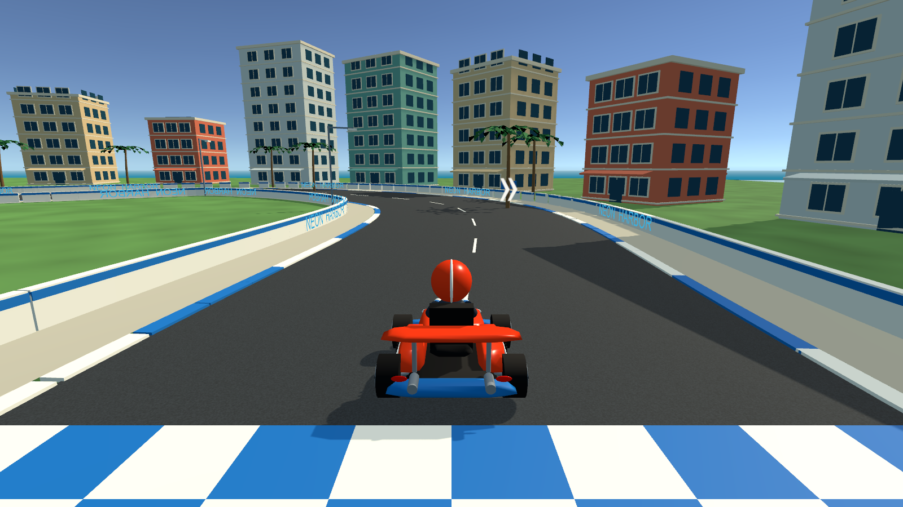

# Neon Harbor · 海港竞速原型

一个基于 **Unity 2022.3.62f1** 的风格化 3D 赛车原型：原创海港赛道、街机手感卡丁车、AI 对手、回放与小地图。



> 场景 `Assets/Scenes/Race_Coast_02.unity`（图中赛道）

## 特性

- **街机卡丁车物理**：油门/刹车/倒车、转向、漂移、氮气加速、车灯
- **AI 对手**：`RacingPath` 闭环路径 + `RaceAIDriver` 按弯道半径推算安全速度、避让、自动漂移
- **回放系统**：30 Hz 记录位置/姿态/输入/计时，比赛结束自动存 JSON，可回放与倒带
- **运行时小地图**：顶视相机 + RenderTexture，HUD 左下角实时显示
- **完整 HUD**：总时间、单圈时间、最佳纪录、圈数/名次、数字时速、圆形转速表、赛道线图
- **原创程序化资产**：车体、车手、楼体、棕榈树、道路与材质全部由 C# 生成或自研，不含第三方 IP

## 操作

| 按键 | 功能 |
| --- | --- |
| `W` / `↑` | 油门 |
| `S` / `↓` | 刹车 / 倒车 |
| `A` `D` | 转向 |
| `Space` | 漂移 |
| `Left Shift` | 氮气（槽满后可用） |
| `L` | 车灯 |
| `Backspace` | 回到最近的赛道位置 |
| `Enter` | 重新比赛 |
| `R` | 冲线后播放回放 / 再按退出回放 |

## 运行方式

1. 用 **Unity Hub** 打开本仓库根目录，编辑器版本选 **2022.3.62f1c1**
2. 打开场景 `Assets/Scenes/Race_Coast_02.unity`
3. 点击 **Play**（先单击 Game 视图获取键盘焦点，并确认顶部 **Pause** 已关闭）

> 仓库只包含工程源码与资源，**不含** `Library/`、`Logs/`、`Builds/` 等生成目录或打包好的可执行文件。

## 目录结构

```
Assets/
├── Art/          模型、贴图、UI 素材
├── Audio/        音效
├── Editor/       程序化建模与场景生成工具（OriginalRaceArt / PlayableDemoSceneBuilder）
├── Materials/    材质
├── Prefabs/      预制体
├── Scenes/       Race_City_01（旧版）、Race_Coast_02（当前默认）
├── Scripts/      ArcadeKart 核心脚本
│   ├── Camera/  Effects/  Replay/  Track/  UI/  Vehicle/
└── ...
Docs/            设计与实现文档（见下）
Packages/        Unity 包清单
ProjectSettings/ 工程设置
```

## 文档

| 文档 | 内容 |
| --- | --- |
| [COAST_02.md](Docs/COAST_02.md) | 新场景说明、操作、画面与 HUD 布局 |
| [RACING_FEATURES.md](Docs/RACING_FEATURES.md) | AI、回放、小地图、UI 模块 |
| [RVP_REFERENCE.md](Docs/RVP_REFERENCE.md) | 物理参考改造说明 |
| [SCENE_SETUP.md](Docs/SCENE_SETUP.md) | 场景搭建步骤 |
| [ASSET_SOURCES.md](Docs/ASSET_SOURCES.md) | 原创资产来源与制作方式 |
| [ART_AND_LIGHTING.md](Docs/ART_AND_LIGHTING.md) | 美术与光照参数 |
| [BUILD_AND_EXPANSION.md](Docs/BUILD_AND_EXPANSION.md) | 打包与扩展说明 |
| [UI_LAYOUT.md](Docs/UI_LAYOUT.md) | HUD 坐标与尺寸 |

## 资产说明

项目内所有车辆、车手、建筑、植被与道路均为**程序化生成的原创资产**（见 `Assets/Editor/OriginalRaceArt.cs`、`PlayableDemoSceneBuilder.cs`），不含《跑跑卡丁车》等第三方作品的角色、车型、Logo、贴图或赛道资产；场景中的 **NEON HARBOR** 为本原型自创标识。

## 许可

本项目仅用于学习与原型演示。
